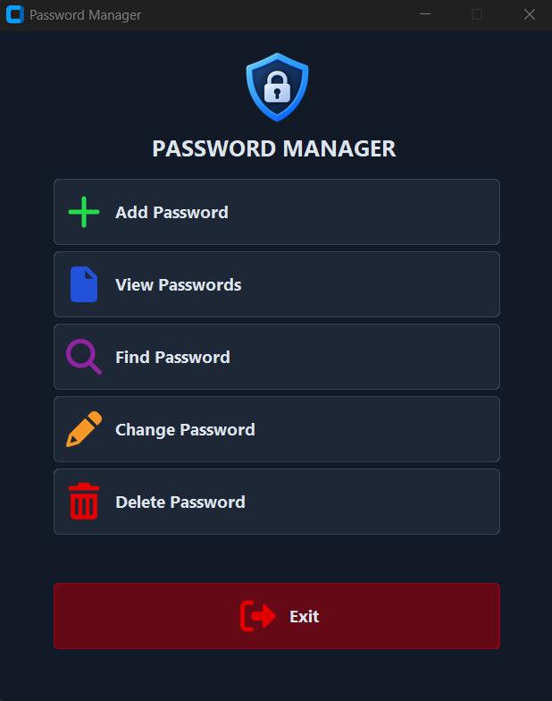

# Password Manager

A simple desktop password manager built with Python, [CustomTkinter](https://github.com/TomSchimansky/CustomTkinter) and SQLite. Built as a learning project to practice GUI development and object-oriented programming.

## Features

- Add, view, find, update, and delete saved website/login/password entries
- Dark-themed desktop UI
- Local SQLite storage, no internet connection required

## Screenshot



## Tech stack

- Python 3
- [CustomTkinter](https://github.com/TomSchimansky/CustomTkinter) — GUI
- [Pillow](https://python-pillow.org/) — image handling for icons
- SQLite3 (standard library) — local storage

## Project structure

- `password_manager.py` — GUI: `PasswordManagerApp` (main window) and a set of `CTkToplevel` subclasses, one per feature (add / view / find / change / delete)
- `database.py` — `PasswordDatabase` class wrapping the SQLite connection and queries

## Getting started

```bash
pip install customtkinter pillow
python password_manager.py
```

Run from the repository root — icon paths (`images/*.png`) and the database path (`password_manager_db/database.db`) are relative to the current working directory.

## Note

Passwords are currently stored and displayed in plain text. This project was built for learning purposes and is not intended for storing real credentials.
